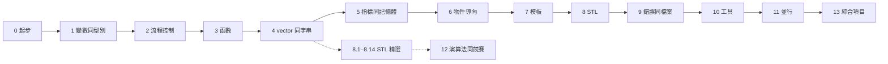

# 廣東話 C++ 全攻略: course plan

A complete C++ course in short Cantonese videos for 香港編程學會 (HKPS). It goes from "what is a
compiler" to templates, the STL, concurrency and contest algorithms. **Every video carries
`hkpsLogo.png`** (see [Logo](#logo)).

- **Language:** spoken Hong Kong Cantonese narration, Traditional Chinese on-screen text,
  English code.
- **Length:** 3 to 6 minutes per video, 8 at most. One idea per video.
- **Size:** 154 videos in 14 parts, about 12 to 13 hours in total.
- **Audience:** secondary school students (12+) to adults with no programming experience.
  Part 12 also prepares students for HKOI.
- **C++ standard:** C++20 is the baseline. Videos that use C++23 say so with a 「C++23」 badge
  and compile with `-std=c++23`.
- **Video:** 1920×1080, 30 fps, H.264 + AAC, loudness −16 LUFS (the same settings as the
  SemiBlock series).
- **Production:** one Python script per video, named by its syllabus id (`video0.1.py`, `video0.2.py`, …), rerun at any
  time to rebuild that video. It uses local OmniVoice TTS and a Whisper check (the voice setup of
  `newblock-server/skills/video`), real C++ runs in Docker, and frames drawn in Python. No
  screen recorder, no microphone. See [Making the videos](#making-the-videos).

---

## Learning paths



| Path | Videos | For |
|---|---|---|
| 入門 Foundations | Parts 0–4 (51 videos) | Writing real programs with input, loops, functions, `vector` and `string` |
| 全面 Complete | Every part except 12 | The whole language, from basics to modern C++ and concurrency |
| 競賽 Contest (HKOI) | Parts 0–4, then 8.1–8.14, then 12 | Algorithms and contest technique without OOP or pointers |

The contest path skips Parts 5–7, so **videos 8.1 to 8.14 must not depend on pointers,
classes or templates** beyond what they explain themselves. For example, 8.2 explains
iterators without relying on 5.5.

---

## Rules for every video

- **One idea, one program.** Each video builds one small program that runs at the end.
- **Code is typed on camera, then compiled and run for real.** All output on screen,
  compiler errors included, comes from a real GCC run, not a mock-up.
- **Show one real mistake.** Most videos break the program on purpose and read the real
  error or wrong output, because beginners spend most of their time there.
- **End with a challenge.** It's a small change the viewer makes alone. The answer is in
  `code/<id>/challenge.cpp`, and the next video can show it in 10 seconds.
- **Reuse, don't re-teach.** When an earlier idea comes back, name the video it came from
  (「喺 3.6 學過」).
- **Strings stay in English until 4.8.** `size()` and `[]` count bytes, so a Chinese string
  gives confusing numbers until UTF-8 is explained in 4.8. Comments can be in Chinese from
  the start.
- **Subtitles are burned in.** They are the narration as written (「C++」, not the TTS
  spelling), in Traditional Chinese, at the bottom of the frame, so the video works muted on
  a phone.

### Scene template

| Scene | On screen | About |
|---|---|---|
| `intro` | Title card: logo, 「1.4」, title | 5 s |
| `goal` | 「今集學識」 card with 1 to 3 points | 8 s |
| `demo` | The finished program running in the terminal | 10–20 s |
| build × N | Code typed into the editor, compiled and run after each step | 2–4 min |
| `concept` | Explainer card (memory boxes, flow arrows, tables) when the idea needs a picture | 15–30 s |
| `mistake` | A real compiler error or bug, read and fixed | 20–40 s |
| `recap` | Three-line summary card | 10 s |
| `outro` | Challenge, next video's title, logo end card | 10 s |

Narration budget: about 1,200 to 2,400 Cantonese characters per video. Cantonese TTS speaks
about 8 characters a second. Scenes that type code need more screen time per character, so
measure the real rate in the pilot.

---

## Syllabus

IDs are `part.video`. Files and folders use the zero-padded form (`01-04`), so 1.4 is
`code/01-04/` and `hkps-cpp-01-04.mp4`.

### Part 0 起步: Getting started (6)

| # | 片名 | Covers | Program on screen |
|---|---|---|---|
| 0.1 | C++ 係乜嘢？ | What C++ is, where it runs (games, browsers, robots, HKOI), compiled vs interpreted, what this course builds | Trailer: clips of the capstones |
| 0.2 | 安裝開發環境 | Windows (MSYS2 GCC + VS Code), macOS (Command Line Tools or Homebrew GCC), Linux, online compilers as a fallback | Step cards with screenshots (not recorded live) |
| 0.3 | Hello, World! | `#include`, `int main()`, `std::cout`, `<<`, `'\n'`, `return 0`, semicolons; compile with `g++` and run | `hello.cpp` |
| 0.4 | 編譯係點運作 | Source → compiler → executable, `-o`, `-std=c++20`, recompiling after every edit | Edit without recompiling and see the old output |
| 0.5 | 睇得明編譯錯誤 | Reading `file:line:col: error`, fixing the first error first, `-Wall -Wextra` warnings | Missing `;`, a `cout` typo, a missing `#include` |
| 0.6 | 註解同寫碼風格 | `//` and `/* */`, indentation, naming, one statement per line | Tidying a messy program |

### Part 1 變數、型別同運算: Variables, types and arithmetic (12)

| # | 片名 | Covers | Program on screen |
|---|---|---|---|
| 1.1 | 變數：俾資料一個名 | Declare, assign and print an `int` | Age next year |
| 1.2 | 初始化 | `=` vs `{}`, narrowing caught by `{}`, uninitialised variables hold garbage | An uninitialised total |
| 1.3 | 基本型別 | `int`, `long long`, `double`, `char`, `bool`, `sizeof` | Sizes and sample values |
| 1.4 | 用 cin 讀輸入 | `std::cin >>`, several values on one line, whitespace | Add two numbers |
| 1.5 | 算術運算 | `+ - * / %`, precedence, integer division, `+=`, `++` | Seconds → h:m:s |
| 1.6 | 整數溢位 | `int` limits, overflow, when to use `long long` | Factorial going wrong at 13! |
| 1.7 | 浮點數同精度 | `0.1 + 0.2`, `std::fixed`, `std::setprecision`, comparing with a tolerance | Adding up prices |
| 1.8 | 型別轉換 | Implicit conversion, `static_cast`, `char` ↔ `int` (ASCII) | Average of integers; letter codes |
| 1.9 | const 同 constexpr | Named constants instead of magic numbers, `std::numbers::pi` | Circle area |
| 1.10 | auto | Type deduction: when it helps and when it hides the type | Rewriting 1.8 with `auto` |
| 1.11 | std::string 入門 | `+`, `size()`, `[]`, `std::getline`, mixing `cin >>` with `getline` | Greeting by full name |
| 1.12 | 小項目：BMI 計算機 | Input, arithmetic, formatted output, constants | `bmi.cpp` |

### Part 2 流程控制: Control flow (11)

| # | 片名 | Covers | Program on screen |
|---|---|---|---|
| 2.1 | if / else | Comparison operators, the `=` vs `==` bug | Pass or fail |
| 2.2 | 邏輯運算 | `&&`, `\|\|`, `!`, short-circuit evaluation | Leap year |
| 2.3 | else if 同巢狀 if | Chains, nesting, why braces matter | Grade A to F |
| 2.4 | switch | `case`, `break`, fall-through, `[[fallthrough]]`, `default` | Menu |
| 2.5 | 條件運算子 | `?:` and when not to use it | Singular or plural |
| 2.6 | while 迴圈 | Condition-first loops, infinite loops and Ctrl+C | Sum until 0 is entered |
| 2.7 | for 迴圈 | Init, condition, update, off-by-one errors | Sum of 1 to n |
| 2.8 | do-while、break、continue | Loops that run at least once, leaving early, skipping | Input validation |
| 2.9 | 巢狀迴圈 | Loops inside loops | Star triangle, times table |
| 2.10 | 隨機數 | `<random>`: `std::mt19937`, `std::uniform_int_distribution`, and why not `rand()` | Dice roller |
| 2.11 | 小項目：估數字 | Loops, conditions, random numbers | Guess-the-number game |

### Part 3 函數: Functions (12)

| # | 片名 | Covers | Program on screen |
|---|---|---|---|
| 3.1 | 點解要用函數 | Defining and calling, `void` | `printLine()` |
| 3.2 | 參數同回傳值 | Parameters, `return`, using the result | `square(x)`, `max3(a, b, c)` |
| 3.3 | 宣告同定義 | Prototypes, why order matters | Calling before defining |
| 3.4 | 傳值 | Parameters are copies | An `addOne` that doesn't |
| 3.5 | Reference 入門 | `int&` as a second name for a variable | Two names, one box |
| 3.6 | 傳參考同 const reference | Changing the caller's variable, avoiding copies with `const std::string&` | `swap` |
| 3.7 | 預設參數同多載 | Default arguments, overloading, ambiguous calls | `area()` for squares and rectangles |
| 3.8 | 作用域同生命週期 | Block scope, globals and why to avoid them, `static` locals | Call counter |
| 3.9 | 遞迴 | Base case, the call stack, stack overflow | Factorial, Fibonacci |
| 3.10 | 拆開多個檔案 | `.h` and `.cpp`, `#pragma once`, compiling several files | `mathutil.h` |
| 3.11 | namespace | Your own namespaces, `std::`, why not `using namespace std;` in headers | Two `print` functions |
| 3.12 | 小項目：計數機 | Functions, `switch`, loops | Menu calculator |

### Part 4 vector 同字串: Collections and text (10)

| # | 片名 | Covers | Program on screen |
|---|---|---|---|
| 4.1 | vector 入門 | `std::vector`, `push_back`, `size`, `[]` | Class marks |
| 4.2 | Range-based for | `for (x : v)`, `auto&`, `const auto&` | Doubling every mark |
| 4.3 | vector 常用操作 | `insert`, `erase`, `clear`, `front`, `back`, `at()` vs `[]` | An out-of-range index caught by `at()` |
| 4.4 | 二維 vector | Grids, rows and columns | Seating plan |
| 4.5 | C 風格陣列 | `int a[5]`, decay, no `size()`, why to prefer `std::array` or `std::vector` | Passing an array to a function |
| 4.6 | std::array | Fixed-size arrays done right | Days in each month |
| 4.7 | 字串操作 | `substr`, `find`, `replace`, `std::to_string`, `std::stoi` | Parsing "HH:MM" |
| 4.8 | 字元同中文字 | `<cctype>` (`isdigit`, `toupper`), counting letters, UTF-8 bytes vs Chinese characters | Password checker |
| 4.9 | 自己寫搜尋同排序 | Linear search, bubble sort, swapping, before the library does it for us | Sorting marks by hand |
| 4.10 | 小項目：井字過三關 | 2D arrays, functions, loops | Two-player tic-tac-toe in the terminal |

### Part 5 指標同記憶體: Pointers and memory (11)

| # | 片名 | Covers | Program on screen |
|---|---|---|---|
| 5.1 | 記憶體同地址 | Bytes, addresses, `&x`, stack vs heap (picture card) | Printing addresses |
| 5.2 | 指標入門 | `int* p = &x`, `*p`, changing a variable through a pointer | |
| 5.3 | 指標 vs reference | Re-pointing, null, syntax | Side by side |
| 5.4 | nullptr 同懸空指標 | Null dereference, dangling pointers, AddressSanitizer catching them | A crash, then the ASan report |
| 5.5 | 指標同陣列 | Array decay, pointer arithmetic | Walking an array with a pointer |
| 5.6 | const 同指標 | `const int*` vs `int* const` | |
| 5.7 | new 同 delete | Heap allocation, `delete[]`, memory leaks | A leak found by LeakSanitizer |
| 5.8 | RAII | Objects that own resources and free them at the end of scope | A scope guard that prints |
| 5.9 | unique_ptr | `std::make_unique`, sole ownership, moving ownership | |
| 5.10 | shared_ptr 同 weak_ptr | Reference counts, cycles, breaking them with `weak_ptr` | Two objects pointing at each other |
| 5.11 | 未定義行為 | Out of bounds, uninitialised reads, signed overflow, `-fsanitize=address,undefined` | Three bugs, three sanitizer reports |

### Part 6 物件導向: Object-oriented programming (18)

| # | 片名 | Covers | Program on screen |
|---|---|---|---|
| 6.1 | struct | Grouping data, member access, aggregate initialisation | `Student` |
| 6.2 | class 同成員函數 | Methods, calling them on objects | `BankAccount::deposit` |
| 6.3 | 封裝：public / private | Hiding data, keeping invariants | A balance that can't go negative |
| 6.4 | Constructor | Default and parameterised constructors, member initialiser lists | |
| 6.5 | Destructor | When it runs, destruction order, RAII again | Printing on create and destroy |
| 6.6 | this 同 const 成員函數 | `this`, `const` methods, why `const` objects need them | |
| 6.7 | static 成員 | Data and functions shared by the class | Counting objects created |
| 6.8 | 運算子多載 | `+`, `==`, `<=>` (C++20), `<<` for printing | `Vec2` |
| 6.9 | 複製 | Copy constructor and copy assignment, shallow vs deep copy, rule of three | A class owning a raw buffer |
| 6.10 | Move semantics | lvalues and rvalues, `std::move`, move constructor | Moving a big buffer instead of copying it |
| 6.11 | Rule of zero / five | Letting members (`vector`, `unique_ptr`) manage themselves | Refactoring 6.9's class |
| 6.12 | 繼承 | Base and derived classes, `protected`, constructor order | `Animal` → `Dog` |
| 6.13 | virtual 同多型 | `virtual`, `override`, base pointers and references | `speak()` |
| 6.14 | 抽象類別 | Pure virtual functions, interfaces | `Shape::area()` |
| 6.15 | virtual destructor 同 final | Deleting through a base pointer, `final` | A leak without a virtual destructor |
| 6.16 | 組合 vs 繼承 | "Has a" vs "is a" | A `Car` has an `Engine` |
| 6.17 | enum class | Scoped enums, `switch` over them | Traffic light |
| 6.18 | 小項目：圖形面積計算器 | Polymorphism, `unique_ptr`, `vector` | A list of shapes and their total area |

### Part 7 模板: Templates (7)

| # | 片名 | Covers | Program on screen |
|---|---|---|---|
| 7.1 | 函數模板 | `template <typename T>`, instantiation | `maxOf` |
| 7.2 | 類別模板 | Class templates | `Stack<T>` |
| 7.3 | 推導同 CTAD | Template argument deduction, class template argument deduction | |
| 7.4 | Concepts | `requires`, standard concepts, readable errors (C++20) | The same error before and after |
| 7.5 | constexpr 函數同 if constexpr | Compile-time evaluation, `consteval`, branching on types | |
| 7.6 | Variadic templates | Parameter packs, fold expressions | `sum(1, 2, 3)`, `print(...)` |
| 7.7 | 小項目：自己寫 MiniVector | Templates, RAII, copy and move together | A growable `MiniVector<T>` |

### Part 8 STL 標準函式庫: The standard library (21)

| # | 片名 | Covers | Program on screen |
|---|---|---|---|
| 8.1 | STL 全景 | Containers, iterators and algorithms, and how they fit together | Map of the library (card) |
| 8.2 | Iterator | `begin`, `end`, `*it`, `++it`, iterator categories | |
| 8.3 | vector 深入 | `capacity`, `reserve`, `emplace_back`, iterator invalidation | |
| 8.4 | pair、tuple、structured bindings | `std::pair`, `std::tuple`, `auto [a, b] = ...` | |
| 8.5 | map | Ordered key → value | Word count |
| 8.6 | unordered_map | Hashing, average O(1), when order doesn't matter | |
| 8.7 | set 同 multiset | Unique sorted values, duplicates | Distinct visitors |
| 8.8 | stack 同 queue | LIFO and FIFO | Bracket matcher; ticket queue |
| 8.9 | priority_queue | Max-heap, min-heap with `std::greater` | Emergency room triage |
| 8.10 | deque 同 list | When they beat `vector`, and when they don't | |
| 8.11 | Lambda | Syntax, capturing by value and by reference | |
| 8.12 | sort 同自訂比較 | `std::sort`, comparators, `stable_sort` | Students by mark, then by name |
| 8.13 | 常用演算法 | `find`, `count_if`, `accumulate`, `transform`, `min_element`, erase-remove | |
| 8.14 | 二分搜尋 | `binary_search`, `lower_bound`, `upper_bound` | |
| 8.15 | Ranges 同 views | `std::ranges::sort`, `views::filter`, `views::transform`, pipes (C++20) | |
| 8.16 | optional | Values that may be missing | `findStudent` |
| 8.17 | variant 同 visit | A value that is one of several types | |
| 8.18 | string_view 同 span | Non-owning views and the dangling danger | |
| 8.19 | std::format 同 std::print | C++20 formatting, C++23 `std::print` | |
| 8.20 | chrono | Durations, timing code | Stopwatch |
| 8.21 | 小項目：單字頻率統計 | `map`, `sort`, lambdas, `string` | Top 10 words in a text |

### Part 9 錯誤處理同檔案: Errors and files (9)

| # | 片名 | Covers | Program on screen |
|---|---|---|---|
| 9.1 | Exception 入門 | `throw`, `try`, `catch`, stack unwinding | |
| 9.2 | 標準同自訂 exception | `std::runtime_error`, `std::out_of_range`, deriving your own | |
| 9.3 | noexcept 同 exception safety | The guarantees, and why RAII makes them work | |
| 9.4 | assert 同 static_assert | Checking assumptions at run time and at compile time | |
| 9.5 | std::expected | Errors as values (C++23) | `parseInt` |
| 9.6 | 讀寫檔案 | `ifstream`, `ofstream`, checking that a file opened, reading line by line | |
| 9.7 | stringstream 同解析文字 | `std::istringstream`, splitting CSV lines | |
| 9.8 | std::filesystem | Paths, listing a folder, file sizes | Folder size |
| 9.9 | 小項目：記帳簿 | Classes, `vector`, files, exceptions | Expense tracker saved as CSV |

### Part 10 工具同工程: Tools and real projects (8)

| # | 片名 | Covers | Program on screen |
|---|---|---|---|
| 10.1 | 編譯三部曲 | Preprocess, compile, link; `-E`, `-c`; "undefined reference" | |
| 10.2 | Preprocessor 同 macro | `#define`, `#ifdef`, include guards, why `constexpr` beats macros | |
| 10.3 | CMake 入門 | `CMakeLists.txt`, build folders, targets | 3.12's calculator built with CMake |
| 10.4 | Debugger | gdb: breakpoints, stepping, printing, backtrace | Finding a bug in a loop |
| 10.5 | 單元測試 | Testing functions with doctest (one header file) | Tests for `isLeapYear` |
| 10.6 | 用第三方庫 | CMake `FetchContent`, nlohmann/json | Reading a JSON file |
| 10.7 | 效能入門 | `-O0` vs `-O2`, timing, cache-friendly loops | Row vs column traversal |
| 10.8 | C++20 modules 簡介 | `export module`, `import`, the state of compiler support | Optional; depends on GCC support at recording time |

### Part 11 並行: Concurrency (7)

| # | 片名 | Covers | Program on screen |
|---|---|---|---|
| 11.1 | thread 同 jthread | Starting and joining threads, `std::jthread` | Two counters |
| 11.2 | Data race 同 mutex | Race conditions, `std::mutex`, `lock_guard`, `scoped_lock` | A broken counter, then fixed |
| 11.3 | atomic | `std::atomic` and when it is enough | |
| 11.4 | Deadlock | Lock ordering, `scoped_lock` over several mutexes | Two threads stuck forever |
| 11.5 | condition_variable | Producer and consumer | |
| 11.6 | async 同 future | `std::async`, `std::future`, `std::promise` | Parallel sum |
| 11.7 | 小項目：平行搵質數 | Threads, atomics, chrono | Speed-up vs one thread |

### Part 12 演算法同競賽: Algorithms and contests, HKOI (16)

| # | 片名 | Covers | Program on screen |
|---|---|---|---|
| 12.1 | 競賽寫法 | Fast I/O (`sync_with_stdio(false)`, `cin.tie(nullptr)`), `bits/stdc++.h` (GCC only), input formats | A contest template |
| 12.2 | 時間複雜度 | Big-O, the "about 10⁸ simple steps a second" rule of thumb, reading constraints | Timing O(n²) vs O(n log n) |
| 12.3 | 前綴和 | 1D and 2D prefix sums | Range sum queries |
| 12.4 | 雙指針同滑動視窗 | Two pointers, sliding windows | Longest subarray with sum ≤ k |
| 12.5 | 二分答案 | Binary search on the answer | Smallest maximum load |
| 12.6 | 貪心 | Greedy choices, sorting first, exchange arguments | Activity selection |
| 12.7 | 回溯 | Permutations, subsets, N-Queens | |
| 12.8 | 位元運算 | `& \| ^ ~ << >>`, bitmasks for subsets | |
| 12.9 | 圖嘅表示 | Adjacency list vs matrix, reading edges | |
| 12.10 | DFS | Recursive DFS, connected components, flood fill | Counting islands |
| 12.11 | BFS | Shortest number of steps on a grid | Maze |
| 12.12 | Dijkstra | Weighted shortest paths with `priority_queue` | MTR-style route |
| 12.13 | 並查集 | Union-find, path compression | |
| 12.14 | 動態規劃入門 | Memoisation, then tabulation | Climbing stairs |
| 12.15 | 經典 DP | 0/1 knapsack, LIS, LCS | |
| 12.16 | 數論基礎 | gcd, sieve of Eratosthenes, modular arithmetic | |

### Part 13 綜合項目: Capstones (6)

| # | 片名 | Covers | Program on screen |
|---|---|---|---|
| 13.1 | 貪食蛇（一）：遊戲迴圈 | Game loop, drawing in the terminal with ANSI escape codes | Snake moving on its own |
| 13.2 | 貪食蛇（二）：鍵盤同碰撞 | Non-blocking keyboard input, collisions | Steering, crashing |
| 13.3 | 貪食蛇（三）：分數同收尾 | Score, speeding up, saving the high score to a file | The finished game |
| 13.4 | 圖書館管理系統（一）：設計 | Choosing classes, ownership and containers | Class diagram card, first classes |
| 13.5 | 圖書館管理系統（二）：完成 | Search, borrow and return, saving to file, tests | The finished system |
| 13.6 | 下一步去邊？ | Game development (raylib), GUIs (Qt), embedded (Arduino, ESP32), HKOI, open source | Short demos, no build |

---

## Logo

`hkpsLogo.png` is the HKPS logo: a blue `{/}` mark above 香港編程學會, 240×240 PNG with a
transparent background. It appears in three places in every video:

| Where | How |
|---|---|
| Title card (`intro`) | Centred above the video number and title, at its native 240 px. Don't upscale it. |
| Every other frame | Top-right watermark: the logo on a white rounded square, 132 px wide, 32 px from the top and right edges. |
| End card (`outro`) | Centred, with 「多謝收睇」 and the next video's title. |

- **The renderer adds the watermark, not the scene.** `cpptut/build.py` pastes it onto every
  frame after the scene has drawn itself, so no scene can forget it. Only cards that already
  show the logo large (`TitleCard`, `EndCard`) skip it.
- **The white square is needed** because the editor uses a dark theme, and the logo's blue
  text is hard to read on dark grey.
- **Keep the top-right corner empty** (about 200 × 200 px) on every card and on the stage,
  so the watermark never covers code or terminal output.
- If HKPS has a larger PNG or an SVG, use it for the title and end cards. At 240 px the logo
  is fine as a watermark but small on a 1080p title card.

---

## Making the videos

Each video is one script in this folder, named by its syllabus id: `video0.1.py` is 0.1,
`video8.20.py` is 8.20. Inside, `N` is the script's row in the syllabus (`video0.1.py` has
`N = 1`, `video1.1.py` has `N = 7`). Rerun a script whenever you change it, and it rebuilds
`out/video<id>.mp4`.

```sh
python3 video0.1.py               # -> out/video0.1.mp4
python3 video0.1.py --draft       # silent, estimated timing, fast encode: for checking layout and pace
python3 video0.1.py --stills      # two PNGs per scene in build/video0.1/stills/ (add --draft to skip TTS)
python3 video0.1.py --redo why    # regenerate one scene's narration (e.g. after changing its seed)
python3 video0.1.py --fresh-runs  # run the C++ programs again instead of using the cached results
```

Any `python3` works: the script switches itself to the video venv
(`newblock-server/skills/video/.venv`, or whatever `CPPTUT_PY` points to). Docker Desktop
must be running the first time a video's programs run. After that, their results are cached
in `build/runs/`.

What a run does:

1. **Runs the programs** in the pinned GCC container (`docker/Dockerfile`) and keeps their
   real output and timings. The narration can quote them; video 1 says how many seconds each
   language took.
2. **Makes the narration** with OmniVoice, cloned from `voices/yue.wav`, one clip per scene.
   Only clips whose text or seed changed are regenerated, at about 20–30 s per clip on the CPU.
3. **Checks every clip with Whisper.** Clips that may be misread are printed as `BAD`, with
   the transcript. Reword the narration, or give the scene `seed=12` (up to 15), and rerun.
4. **Times the scenes.** A scene lasts as long as its narration plus a short gap, or as long
   as its on-screen actions if those take longer. Actions are tied to `[[cue]]` markers in the
   narration, so a clip that comes out longer or shorter just moves them.
5. **Renders the frames** in Python (Pillow), adds the logo badge and the subtitles, and
   encodes 1080p30 H.264 with the narration normalised to −16 LUFS.
6. **Checks the file:** a full decode that must report no errors, and contact sheets in
   `build/video<id>/sheet-*.jpg`.

### Writing the next video

Copy `video0.1.py` to `video<id>.py`, set `N` to its syllabus row, and replace the scenes. A scene is an id, its
narration, and what is on screen:

```python
Scene("demo_cpp",
      "首先用 g++ 將程式編譯好。[[run]]然後運行佢……",
      stage.scene(Run(compile_), Run(run_cpp, at="run")))
```

- **Narration** is written the way the subtitles should read. `cpptut/text.py` swaps in TTS
  spellings (`C++` → `C plus plus`, `HKOI` → `H K O I`); add new ones to `SAY` there.
- **`[[cue]]` markers** set when things happen. Any `at=` takes a cue name, `(cue, seconds
  after)`, plain seconds, or `None` (there from the start).
- **Cards** (`cpptut/visuals.py`): `TitleCard`, `BulletCard`, `TileCard`, `TimelineCard`,
  `FlowCard`, `BarCard`, `RoadmapCard`, `EndCard`, or a plain `Card` with your own items.
- **The stage** (`cpptut/stage.py`) is an editor and a terminal, and keeps its state from one
  scene to the next. Its events run in order:
  - `Open(file)` shows a file: line by line, typed, at once, or empty.
  - `Type(file, text, after=…)` and `Replace(file, old, new)` edit it on camera. `Replace`
    selects only the characters that change.
  - `Mark(lines)` highlights lines and dims the rest.
  - `Note(text)` shows a callout over the terminal or the editor.
  - `Run(result)` types a command, waits for its real run time and prints its real output,
    in g++'s own colours. With `recall=True` the command comes back as if ↑ was pressed.
  - `Expect(file, text)` stops the build if the code on screen isn't exactly the code that
    was compiled.
  - `Stage(split=…)` sets the editor/terminal widths; `split=0` is a terminal only.
- **Programs** live in `code/<id>/` (for example `code/00-03/hello.cpp`) and run through
  `cpp.session(files, steps)`. Steps are shell commands or `Write(name, text)`, which
  changes a file between commands the way an edit on camera does. Commands run in a
  pseudo-terminal, so g++ colours and `ls` columns look the way they do for a student.
- **Titles come from this README.** Video titles, part names and the "next video" line are
  read from the syllabus tables above, so keep their format.

### Why a Linux container rather than the Mac's compiler

`g++` on macOS is Apple clang. It has no `bits/stdc++.h` (needed in 12.1) and no gdb (10.4),
and LeakSanitizer (5.7) doesn't run on macOS. The image is pinned to one GCC major version
(`gcc:15`) for the whole series, so error messages look the same in every video. It also has
python3 (for video 1's race), gdb and cmake, and runs with `--cap-add=SYS_PTRACE` so gdb and
LeakSanitizer work. The image tag is derived from the Dockerfile, so editing the Dockerfile
rebuilds the image and reruns the programs.

### Not built yet

- **Programs that read `cin`** (from 1.4): `Run` shows a command and its output, but not
  input typed while the program runs. Run the program with its input piped in, and add a
  `Run` option that shows those input lines typed among the output.
- **Snake (13.1–13.3)** needs live key presses and screen redraws. Those frames will have to
  come from a real terminal session rather than from `Run`.
- **The program check script** described below.

### Every program is tested

`code/<id>/` holds each video's `main.cpp`, plus `input.txt` and `expected.txt` when the
program reads input. Add `broken.cpp` with the expected error text for `mistake` scenes, and
`challenge.cpp` for the answer. A check script compiles every program in the same container
with `-Wall -Wextra -Werror -fsanitize=address,undefined` and compares the output. Run it
before recording, so no video shows code that doesn't compile.

### Cantonese narration

Follow "Writing Cantonese scripts" in `skills/videoTutorial.md`. On top of that:

- **Say technical terms in English, the way Hong Kong programmers do** (「呢個 pointer 指住個
  variable」). The first time a term appears, the card shows both: 「指標 pointer」.
- **Card terms:** 變數 variable, 型別 type, 函數 function, 參數 parameter, 迴圈 loop, 陣列 array,
  字串 string, 指標 pointer, 參考 reference, 類別 class, 物件 object, 繼承 inheritance,
  模板 template, 編譯器 compiler, 例外 exception, 執行緒 thread.
- **Code symbols need spelling help for the TTS.** These are candidates, not yet tested.
  Check each one with `tts_variants.py` and Whisper before writing scripts, as was done for
  the IoT and LogicSim terms:

  | On screen | Try in the script |
  |---|---|
  | `C++`, `g++` | `C plus plus`, `G plus plus` |
  | `std::cout`, `std::cin` | `S T D see out`, `S T D see in` |
  | `#include` | `include` |
  | `++i`, `==`, `!=` | `plus plus i`, 「等如等如」, 「唔等如」 |
  | `->` | 「箭咀」 |
  | `nullptr`, `unique_ptr` | `null pointer`, `unique pointer` |
  | `constexpr` | `const expr` |
  | `std::vector<int>` | 「int 嘅 vector」 |

### Layout

```
cantonese-cpp-video-tutorial/
├── README.md           this plan (and the syllabus the scripts read)
├── hkpsLogo.png        the logo on every video
├── video0.1.py …       one script per video
├── cpptut/             the shared library: narration, cards, stage, Docker runs, build
├── code/00-01/         the programs each video shows (input.txt, expected.txt, … as needed)
├── docker/Dockerfile   the pinned GCC image
├── voices/yue.wav      the reference voice every clip is cloned from
├── build/              generated: narration clips, run results, stills, contact sheets (gitignored)
└── out/                the finished videos (gitignored)
```

### Order of work

1. **Tools:** done. The GCC container, the renderer, the logo badge and the cards are in
   `cpptut/`.
2. **Part 0:** done. `video0.1.py` to `video0.6.py` cover 0.1 to 0.6. Review them with HKPS for
   voice, pace, font size and logo placement before making more.
3. **Part 1 next.** Video 10 (1.4, `cin`) needs the input feature under "Not built yet" first.
4. **Produce part by part.** Release a part when all its videos pass the checks below.

### Checks before a video ships

The usual checks from `skills/videoTutorial.md`: Whisper on every clip, a full decode
(`ffmpeg -v error -i final.mp4 -f null - 2>&1 | wc -l` prints 0), and a contact sheet.
For this course, the contact sheet must also show:

- the logo on the title card, on the end card and in the corner of every frame;
- code that is readable and not covered by the watermark;
- terminal output that matches `code/<id>/expected.txt`.

---

## Open decisions

1. **Voice.** The SemiBlock series uses `skills/video/voices/yue.wav`, a young female voice
   designed for kids. This course has an older audience and a different brand, so I
   recommend designing a calmer HKPS voice once, during the pilot, and cloning it for every
   video.
2. **Logo file.** Is there a higher-resolution PNG or an SVG for the title and end cards?
3. **Series title.** 「廣東話 C++ 全攻略」 is a working title.
4. **Where it's published.** The plan assumes 16:9 on YouTube. If Reels or Shorts are wanted
   too, decide early, because a 9:16 version needs its own stage layout.
5. **English versions.** The pipeline supports them (as the three.js and Maze Mice series
   show), but they are not in this plan.
